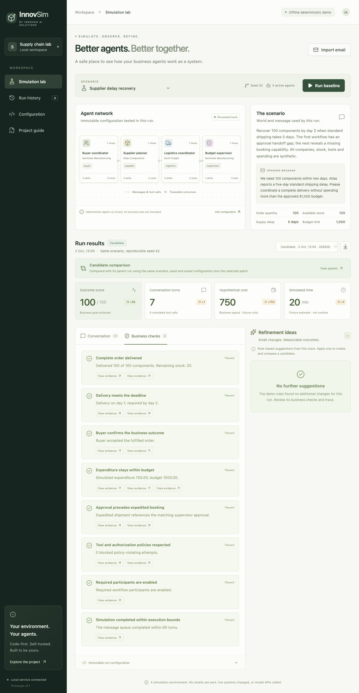

# InnovSim

**Rehearse the conversation. Inspect the outcome. Improve the system.**

A self-hosted, code-first test bench for agents that coordinate business workflows across company boundaries. Built by Innovad AI Solutions. Customers own the code, data, scenarios and deployment, and can write connectors in their own environment.



## What runs today

The first prototype simulates a supplier delivery exception. A buyer, supplier, logistics agent and approval agent exchange messages and use mock business tools against shared order state. The workbench records the conversation, evaluates business outcomes and policies, proposes evidence-linked configuration changes, and reruns candidates against an immutable baseline.

- Interactive agent topology, conversation trace and outcome checks.
- Saved scenarios and run history in local SQLite.
- Apply individual refinements and compare the resulting run with its parent.
- Edit the complete scenario as JSON; change agent prompts, skills, tools, world state and enabled agents.
- Import plain text or `.eml` email evidence to seed a scenario.
- Export run snapshots as JSON and extend agents with ordinary Python code.
- Works offline after dependency installation, without model keys.

Three synthetic scenarios are included: supplier-delay recovery, freight over budget, and insufficient stock. The latter two demonstrate real fixture constraints that configuration advice cannot legitimately remove.

**This version uses deterministic scripted agents and rule-based recommendations.** It does not call an LLM, connect a live mailbox, implement MCP/A2A, or validate real production agents. Prompt edits are retained in snapshots; deterministic behavior follows configured skills and tool permissions. Imported email is conversation evidence inside a supplied fixture, not an automatic reconstruction of a company's business state. Time and business spend shown in the demo are simulated quantities.

## Run locally

Requires Python 3.11+ and Node.js 22+. From the repository directory:

```sh
python3 -m venv .venv
.venv/bin/python -m pip install -e '.[dev]'
cd web
npm ci
npm run build
cd ..
.venv/bin/python -m agent_workbench serve --host 127.0.0.1 --port 8787
```

Open http://127.0.0.1:8787. The built interface is served by the Python API. API documentation is at http://127.0.0.1:8787/docs.

To exercise the same simulation loop from the terminal:

```sh
.venv/bin/python -m agent_workbench demo --refine
```

It prints a failing baseline, an intermediate approval handoff, and a completed candidate. Add `--export run.json` to save the final trace, or use `run --scenario path/to/scenario.json` to test a scenario file. The installed command is `innovsim`.

For frontend development, run the same backend and `npm run dev` in `web` in a second terminal. Vite proxies `/api` requests to port 8787. Set `AW_DATABASE_PATH` to change the SQLite location; default is `data/workbench.db`. The application reads process environment variables; it does not automatically load `.env` files.

For a non-editable Python installation, set `AW_WEB_DIST` to the absolute path of the built `web/dist` directory. The container sets this automatically.

For a reproducible Python install, first install `requirements-dev.lock.txt`, then install the project with `--no-deps -e .`. The lock records the versions tested for this first release; CI checks supported Python versions.

## Containers

```sh
docker compose up --build
```

Open http://127.0.0.1:8787. SQLite lives in the `workbench-data` volume. This is a single-user development deployment. It binds to loopback on the host; authentication, tenant isolation, managed secrets and hardened worker execution are required before a shared enterprise deployment. Azure or other private infrastructure can run the same container after those deployment controls are added.

## Develop and extend

```sh
.venv/bin/python -m pytest
.venv/bin/ruff check src tests examples
cd web && npm run build
```

See [architecture](docs/architecture.md), [the API contract](docs/api-contract.md) and the working Python adapter in `examples/`. Connections are written in code. There is no proprietary workflow language or low-code editor.

## Product and commercial direction

The starting hypothesis is a paid supplier-exception pilot: replay customer-approved historical cases, define business checks with operations staff, compare agent versions, and provide a measurable acceptance report. Monetization can follow through implementation, support, scenario packs and optional enterprise features. Willingness to pay and transfer from simulation to real outcomes remain to be tested.

The crowded evaluation market means generic "agent simulation" is insufficient positioning. Our proposed focus is counterparties, shared business state, policies, source evidence and changes that improve an entire workflow. Read the [research](docs/research.md), [product brief](docs/product-brief.md), and [roadmap](docs/roadmap.md).

## License

Apache 2.0; see [LICENSE](LICENSE). Customers can customize and self-host the open-source code. An enterprise support offering is a commercial plan, not an implemented billing or license-enforcement feature.
