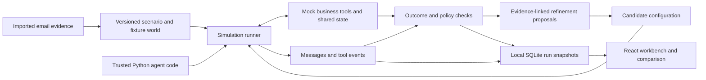

# Architecture

## Design decision

Use Python for simulation, assertions and integration adapters; React/TypeScript for the workbench. Keep protocol and vendor integrations behind an adapter boundary. A runtime such as LangGraph, CrewAI or a customer's own agent service should not have to be rebuilt in this platform.

Python has a direct path into evaluation tooling and business integrations. [FastAPI](https://fastapi.tiangolo.com/features/) provides typed validation, OpenAPI and a small web layer. The browser needs TypeScript for reliable trace/configuration interfaces. Rust is an option for a measured CPU or isolation bottleneck; it adds a language and packaging boundary without solving the first pilot's main problems of scenario fidelity and outcome validation.

## First vertical slice

The API contract is in [api-contract.md](api-contract.md). Scenarios are editable; completed runs contain immutable configuration snapshots. Refining a run produces a new run with the parent ID and same seed. Recommendations are proposals, and tests evaluate the resulting behavior; recommendations themselves do not establish improvement.

The default adapter is deterministic. Skills and available mock tools govern actions. Free-text prompts are saved for future inference adapters, but this version does not pretend to interpret them. Costs and elapsed business time are simulated quantities. The working Python extension example demonstrates the adapter seam with trusted local code.

## Import and replay semantics

An imported `.eml` or plain-text email starts a new scenario built on the supplier fixture. Its body provides conversation context. Inventory, dates, approval policy and counterpart personas remain synthetic and editable. The prototype does not extract an authoritative order or infer a reliable counterparty from a single email. Attachments and live mail access are outside this release.

Later imports need provenance, de-identification, thread grouping, timestamps and reviewer corrections. Separate observed source messages, inferred facts and hypothetical branches in both storage and UI. Chronological replay must hide future messages from the tested agent. Split development cases from held-out acceptance cases before optimization.

## Extension boundaries

1. **Agent adapter:** pass bounded conversation/context into a local function or an explicitly configured remote agent; obtain structured actions and messages.
2. **Tool adapter:** map calls into an isolated mock world, recorded tool output, or a narrowly controlled read-only connector.
3. **Scenario compiler:** turn reviewed business evidence into versioned scenarios and counterpart personas.
4. **Evaluator:** check business state, policy compliance and tool traces independently of the optimizer.
5. **Refiner:** propose typed, reviewable patches to prompts, skills, tools or topology. Evaluate candidates against regression cases and held-out cases.

Only the first two seams have a local prototype implementation; protocol-specific and model integrations are future work. [MCP](https://modelcontextprotocol.io/docs/learn/architecture) connects an agent to tools and context, while [A2A](https://a2a-protocol.org/latest/) addresses interaction between agent applications. Neither replaces scenario state, independent outcome checks, or a test harness. Pin and test actual protocol versions when building those adapters.

## Deployment progression

The prototype is a local single-user process with SQLite and a browser client. Local Python adapters are trusted code, not sandboxed uploads. No API route accepts executable code or arbitrary destination URLs. The supplied runner uses mock actions and no paid inference.

For shared deployments, add authentication/RBAC, audit logging, encrypted secrets, PostgreSQL, a job queue and isolated execution workers with explicit network/tool capabilities. Add per-run budgets, timeouts, cancellation and retry/idempotency rules before connecting real services. Customers can host those workers and agents locally or within their private cloud. The platform should return proposals and acceptance reports; promoting a configuration into an operational agent remains an explicit separate action.
